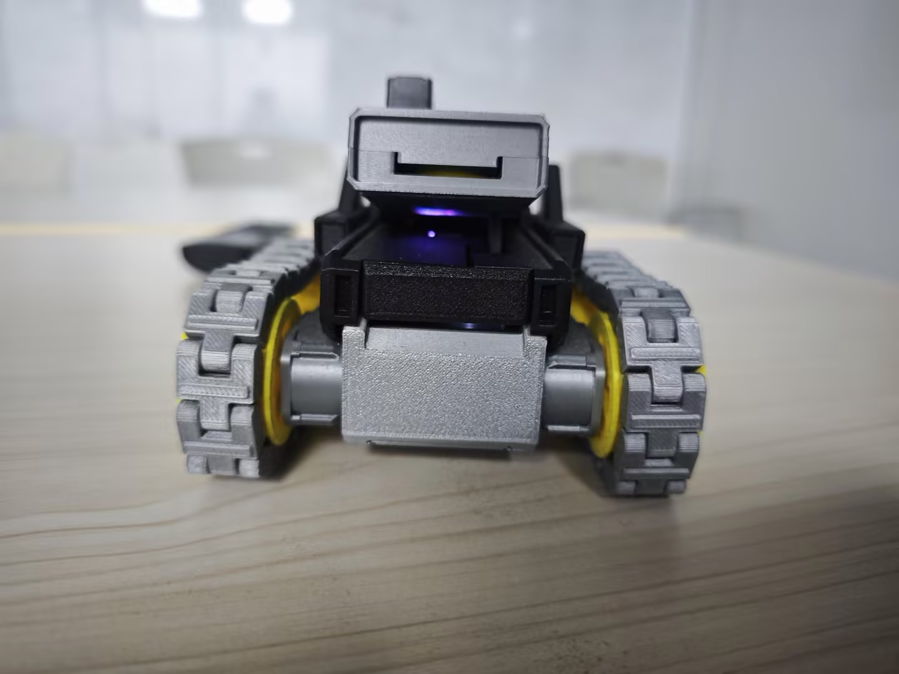
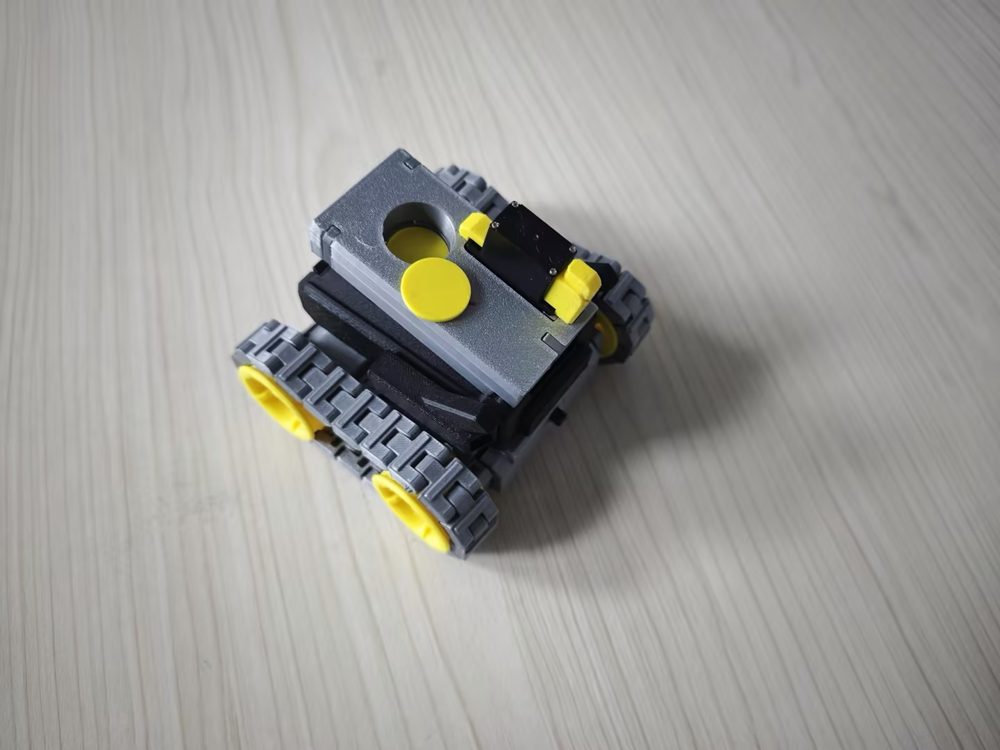
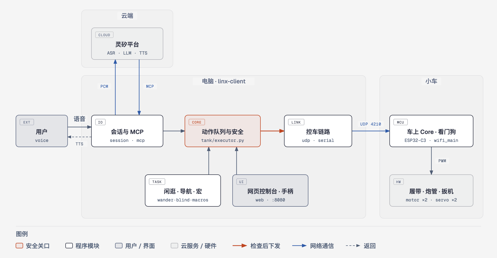
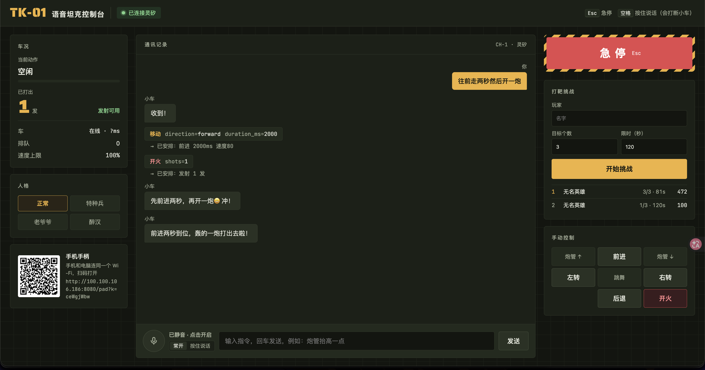
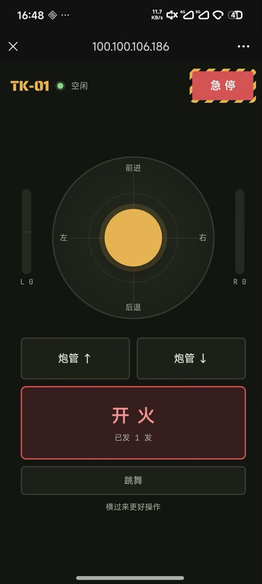

# CyberBrick 语音坦克

[](https://github.com/tibelf/cyberbrick-linxi/actions/workflows/tests.yml)
[](https://github.com/tibelf/cyberbrick-linxi/actions/workflows/tests.yml)

一辆能发射子弹的 CyberBrick Mini T 履带车，接入**灵矽（Linx）**语音交互。对它说「往前走两秒，左转，开一炮」，它会照做并语音回应。没有灵矽实体硬件，由电脑模拟一台灵矽设备，通过 Wi-Fi 控车。

<p>
  
  
</p>

## 主打功能

1. **发射炮弹、绕杯子一圈**
2. **跳舞**
3. **录制动作宏**：用语音教小车一套动作并起个名字，以后说名字就执行（示例：「全军出击」= 全速前进 5 秒）
4. **闲逛**：自己在屋里探索，随机挑方向和距离
5. **老爷爷模式**：慢悠悠地开，走一会歇一会

## 架构



用户的语音经电脑上的 `linx-client` 上传到灵矽平台，平台用 MCP 调用小车工具；语音指令、闲逛等长任务、网页和手机手柄的操作，全部经过动作队列的安全检查，再经 Wi-Fi 发给车上的 Core。详见 [架构设计](docs/架构设计.md)。

## 界面

网页控制台（电脑）：通讯记录、车况、急停、打靶计分、手动控制。手机扫码打开遥控手柄。

<p>
  
  
</p>

## 文档

- [运行说明](docs/运行说明.md)：安装、激活、接车、演示脚本
- [架构设计](docs/架构设计.md)：三层架构、模块规格、设计取舍、分工
- [linx-client/](linx-client/README.md)：客户端代码和参数说明
- [交接看板](docs/HANDOFF.md)：开发过程记录和实测结论

## 快速开始

```bash
cd linx-client
pip install -r requirements-dev.txt
python -m linx_client activate                 # 打印激活码，到灵矽智控台绑定
python -m linx_client run --backend udp --web  # 连灵矽 + Wi-Fi 控车 + 网页控制台 http://localhost:8080
```

第一次用请按 [运行说明](docs/运行说明.md) 从头做。
