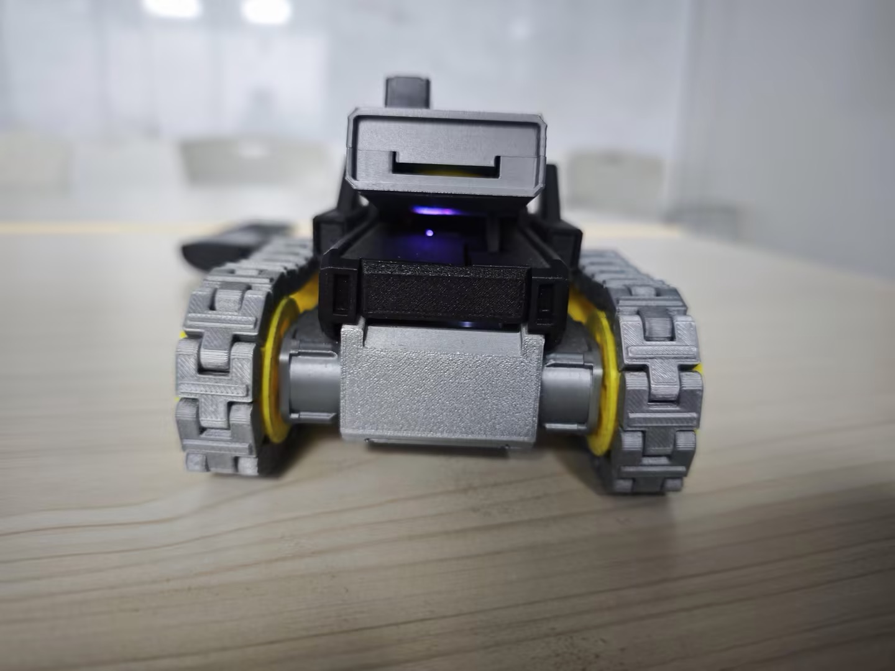
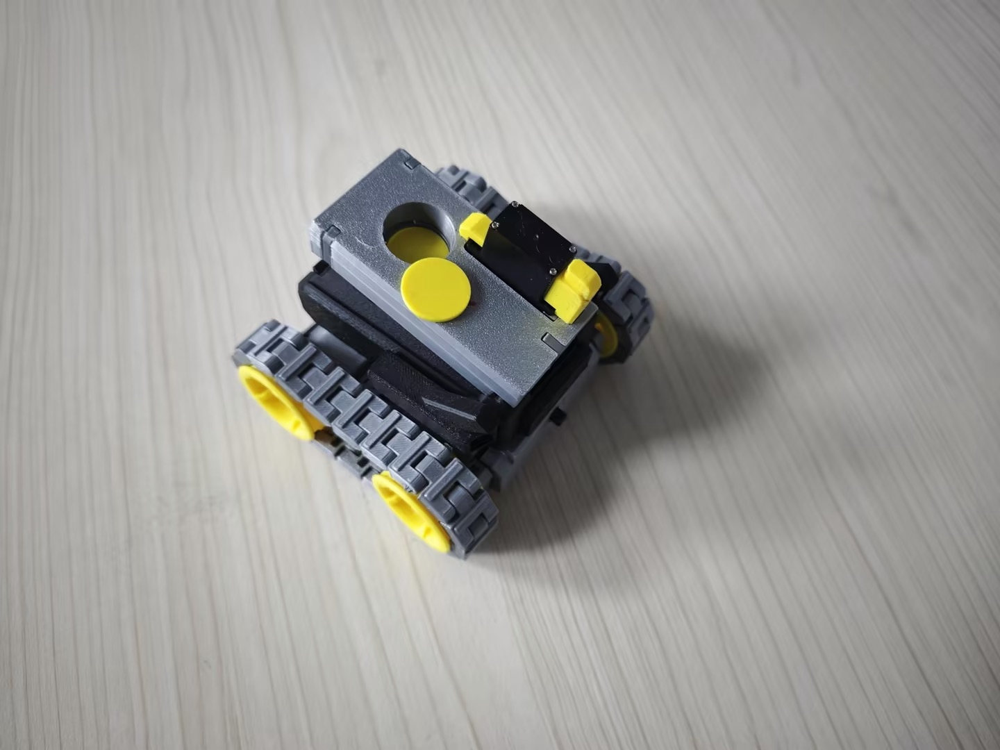
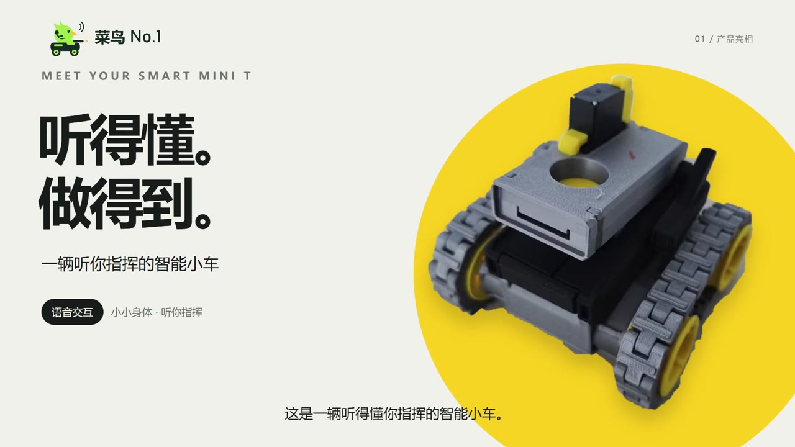

# CyberBrick 语音坦克

用手机操控一辆 CyberBrick Mini T 履带车，接入**灵矽（Linx）**实现语音交互。手机通过原生 Android App 或网页连接云服务器，小车通过 2.4 GHz Wi-Fi / 手机热点主动连云；可以手动驾驶，也可以对手机说「前进一秒然后停」，由灵矽理解指令并语音回复。

**当前主线：手机 → 云服务器 → 小车，日常使用无需电脑。** `linx-client` 在云端承载灵矽设备会话和动作排程，手机负责收音、播报和操作，小车 Core 负责执行。电脑用于初次配置、程序更新和开发调试；车端云连接配置完成后，可使用车载电池脱离 USB 运行。

  
  

## 手机可以做什么

| 功能 | 使用方式 |
|---|---|
| 手动驾驶 | Android App 拖动圆形摇杆控制双履带；网页按住方向键行驶，松手停车 |
| 语音交互 | 点击开始说话、再次点击结束；手机播放灵矽回复，并显示识别文本和状态 |
| 炮台调整 | 点击上 / 下，每次微调 200 ms |
| 单发控制 | 在当前连接中启用发射后点击单发；停车、断线或切后台会重新锁定 |
| 自动连接 | 小车开机读取已保存的热点及云端配置并尝试重连；Android 保存连接后下次启动自动连接 |

同一时刻只允许一个手机控制端；从网页切换到 App 前先断开网页。当前云端及车端限速为 40，保留动作时限、发射冷却和看门狗。摄像头暂未接入云端主线。

## 架构

<picture>
  <source media="(prefers-color-scheme: dark)" srcset="docs/images/cloud-architecture-dark.svg">
  
</picture>

[查看大图](docs/images/cloud-architecture.svg) · [深色版](docs/images/cloud-architecture-dark.svg) · [图源与设计说明](docs/images/cloud-architecture-style.md)

手机和小车分别连接云端，无需电脑中转，也无需在热点上开放入站端口。手动操作直接进入云端排程；语音由灵矽转换为 MCP 工具调用，再经过同一执行器。车端检查指令编号、时效和参数，设备看门狗负责超时停车。

灵矽 Device-Id 保存在服务器私有状态文件中；手机使用控制密码，小车使用独立设备口令。协议与当前部署说明见 [小车直连云端](docs/云端直连实车.md)。

## 快速开始

### 已配置好的小车

1. 打开已保存在车上的 **2.4 GHz Wi-Fi / 手机热点**，确认网络能访问互联网，再打开小车电源。
2. 选择一个手机入口：安装 [Android 原生 App](android-app/README.md)，或打开已部署服务的 HTTPS 网页。首次使用填写该服务的连接信息和控制密码；App 成功连接后可加密保存，下次启动自动连接。
3. 等待显示「真实小车在线」。首次验证先卸弹并架空履带，拖动摇杆或按住方向键，松手应停车。
4. 点击「点击开始说话」，首次允许麦克风权限，说「前进一秒然后停」，再点击「结束说话」。语音实时上传，平台可能在结束录音前响应，无需长按按钮。

小车会保留网络及云端配置；热点名称和密码不变时，重新开机将自动尝试连接。网页断开后需重新点「连接」。恢复原厂遥控、更新网络及故障排查见 [使用与恢复](docs/云端直连实车.md#使用与恢复)。

### 首次搭建或开发

需要云服务器、可用的 HTTPS 入口、灵矽智能体和 CyberBrick Core；Android App 支持 Android 8.0+，网页入口无需安装。初次配置车端时需要电脑和 USB 数据线。

- **云端程序**：从 [linx-client 云端运行说明](linx-client/README.md#云端模式当前主线) 开始，配置手机控制口令、独立设备口令、灵矽绑定和 HTTPS/WSS 代理。
- **车端程序**：使用 [`firmware/car/`](firmware/car/) 的云端启动程序及私有网络、证书配置。现有部署记录见 [小车直连云端](docs/云端直连实车.md)；仓库尚未提供完整的一键云端装车命令，`wifi-setup` 安装的是局域网方案。
- **原生 App**：按 [Android 构建说明](android-app/README.md#构建) 生成 APK。0.2.1 仅本地打包交付，仓库不包含 APK、控制密码或设备身份。

## 验证进度

| 项目 | 当前结果 |
|---|---|
| 手机网页 → 云端 → 实车 | 已确认按键转动与松手停车、语音回复、拔掉 USB 后语音驱动履带并停下 |
| 炮台与扳机 | 已确认上下调整与空载扳机动作；未测试有弹发射 |
| Android | 0.1.0 已确认安装、连接和语音回复；0.2.1 自动连接、圆形摇杆已通过构建与模拟测试，手机体验及实车动作待确认 |
| 现场运行 | 当前云端实测为卸弹架空；真实断网停车、当前限速下地面行驶及完整断电重启仍待验证 |

详细记录见 [交接看板](docs/HANDOFF.md)。

## 电脑模式与早期演示

仓库仍保留电脑运行 `linx-client`、通过局域网 UDP / USB 控车的方式，适合开发和调试。动作宏、闲逛、视觉导航和打靶计分等扩展由电脑模式提供，尚未接入当前云端入口；使用方法见 [电脑模式运行说明](docs/运行说明.md)。

这段约 2 分钟的视频展示早期电脑模式的产品介绍、行驶风格和地毯实车演示。可查看 [仓库视频](docs/demo/demo.mp4) 或 [百度网盘](https://pan.baidu.com/s/1k9dztL7EulGWFYpBwRR4GQ?pwd=t991)；当前手机云端流程以本文说明为准。

## 文档与代码

| 入口 | 内容 |
|---|---|
| [云端直连实车](docs/云端直连实车.md) | 当前使用、重连、恢复原厂和验证边界 |
| [Android 原生 App](android-app/README.md) | 安装、自动连接、摇杆、语音与本地构建 |
| [linx-client](linx-client/README.md) | 云端 / 电脑模式入口、配置和测试 |
| [车端程序](firmware/car/) | MicroPython 启动、云端通道及执行器驱动 |
| [部署模板](deploy/cloud-demo/) | 早期模拟服务的 systemd / Nginx 模板；实车设备入口需另行配置 |
| [电脑模式架构](docs/架构设计.md) / [技术方案](docs/技术方案.md) | 历史扩展功能、工具与本地控制协议 |
| [交接看板](docs/HANDOFF.md) | 当前进度、实测结论和后续事项 |
