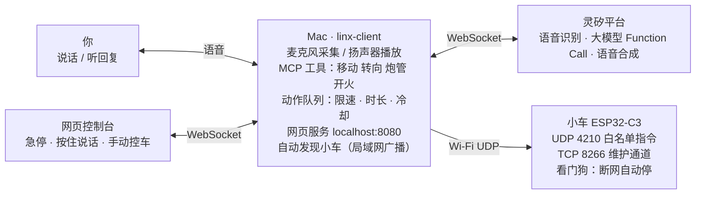

# CyberBrick 语音坦克开发记录 2026-10-24

2026-10-24 · 原文为在线文档，导出到仓库存档

## 结论

今天结束时，小车已经可以**不插线、用语音或网页控制**。对着 Mac 说「往前走两秒然后开一炮」，灵矽平台负责听懂，Mac 通过 Wi-Fi 把动作发给小车执行。

- 前进、后退、原地转向（按角度）、炮管抬高和压低、开火，都能用语音、文字或网页按钮触发。
- 网页控制台：对话记录、急停（Esc）、按住说话（空格）、手动控车、小车状态。
- 装车后不用拆开插 USB：可以通过 Wi-Fi 更新车上的程序、远程调试。
- 安全兜底：断网或电脑程序崩溃时，车在当前动作结束后 0.3 秒内自己停下；开机时按住主控板按键可以回到原厂遥控。

代码都在 [PR #2](https://github.com/tibelf/cyberbrick-linxi/pull/2)，共 20 个单元测试全部通过。还剩一件事没确认：转向改为满速后 90° 是否准确。

## 今天的经过

按时间顺序分七步，每一步写清楚想做什么、碰了什么壁、最后怎么解决。

### 1. 从遥控器里读出接线

- **想做**：用 USB 连上遥控器，读出里面的配置文件，弄清楚车上每个端口接的是什么。
- **碰壁**：原厂程序用 Ctrl-C 打断不了；mpremote 一打开串口就把芯片复位；想绕开程序直接读 Flash，又被芯片的安全模式拒绝。
- **解决**：发现只有遥控器和车配对连着时 Ctrl-C 才有效。于是保持配对，用自己写的脚本把文件全部备份了下来。
- **收获**：配置文件 `rc_config` 给出了真实接线，还发现之前代码里「发射」和「左履带」都接错了：发射其实是一个扣扳机的舵机，不是电机。

### 2. 遥控器突然控制不了车

- **碰壁**：拔掉 USB 后，遥控器连不上车了，当时担心是不是把车弄坏了。
- **原因**：车其实没动过。遥控器的摇杆 5 分钟没人碰，就会自动深度休眠；另外车的电池也快没电了。
- **解决**：推一下摇杆唤醒遥控器，给电池充电。

### 3. 调研蓝牙控车（后来没用上）

- **想做**：当时以为车没有 USB 口，打算冒充官方 App，用蓝牙控车。
- **结果**：读官方开源代码，整理出了指令格式。后来发现车其实有 USB，这条路就没再继续。

### 4. 用 USB 接车，重写控车驱动

- **想做**：按真实接线重写控车代码，在实车上验证。
- **碰壁**：第一次插上 Mac 识别不到车；识别了以后，指令发过去了电机却不转。
- **原因**：电池没电。插着 USB 时主控板照常工作，但电机和舵机必须靠电池驱动。
- **解决**：充好电后把车架空，一项一项测。左右履带的位置和前进方向都对，扳机也能来回动作。

### 5. 改成 Wi-Fi 无线控车

- **想做**：车装好之后就插不了 USB 了，所以要改成无线控车，并且还能无线更新车上的程序。
- **碰壁**（一连四次）：
  1. 家里的 Wi-Fi 是 5G 的，车的芯片只支持 2.4G。
  2. 让车扫描 Wi-Fi 时卡住了：原厂遥控链路已经占着无线模块。
  3. 车连上了 Wi-Fi，Mac 却找不到它：Mac 上虚拟机留下的虚拟网卡把找车的广播包发到了别处。
  4. 无线维护连不上：车的固件里没有 MicroPython 自带的远程调试模块 WebREPL。
- **解决**：改连同一台路由器的 2.4G 网络；跳过重复开启无线；找车时固定从正在上网的网卡发广播；在车上的程序里自己写了一个带密码的维护通道。另外加了两条退路：可以配置多个 Wi-Fi，都连不上时车自己开热点；开机时按住按键可以回到原厂遥控。

### 6. 做网页控制台

- **想做**：不在终端里操作，用网页看对话、按按钮。
- **取舍**：浏览器发不了 UDP，而要用麦克风，页面又必须是 HTTPS，纯手机网页很难做。最后选择在 Mac 上开一个本地网页作为界面，连平台和控车仍由 Mac 上的程序完成。
- **结果**：用真实平台跑通了文字指令，页面上有对话记录、急停、按住说话和手动控车。

### 7. 放到地上实际开，边开边调

- **碰壁 1：前进很慢，履带像带不动**。当初为了安全限速 40%，电机在这么低的功率下扭力不够。→ 默认速度提到 80%，限速放开到 100%。
- **碰壁 2：转向又慢又小**。原来转向时只转一侧履带。→ 改成原地转向（两条履带反向转），并且按角度换算时长。实测满速转 0.4 秒正好 90°。
- **碰壁 3：说「左转 90 度」只转了 45 度**。转向用的是 80% 速度，低速时履带打滑严重，转得比预计慢很多。→ 转向固定用满速。
- **碰壁 4：说「炮管抬高」，炮管却往下压**。这个舵机管的是炮管俯仰，不是炮塔左右转，但工具只提供了「左/右」，大模型只能猜。→ 工具改成「抬高/压低」，方向已实车确认。
- **碰壁 5：满速转向后，有一小会儿找不到车**。怀疑两个电机同时反向启动的电流太大，把电池电压拉低，主控板重启了，还没证实。→ 观察中。

## 现在的架构

Mac 是中枢：它冒充灵矽设备，把你的声音送到平台；平台调用的控车工具先进 Mac 的动作队列做安全检查，再通过 Wi-Fi 发给小车。小车只接受固定的几种指令；维护通道要先输入密码。

## 硬件事实

接线来自车和遥控器上的 `rc_config`（两边完全一样），方向和参数是实车测出来的。

| 部件 | 端口 | 引脚 | 说明 |
| --- | --- | --- | --- |
| 右履带 | MOTOR1 | Pin4 / Pin5 | 正值前进 |
| 左履带 | MOTOR2 | Pin6 / Pin7 | 反装，前进要发负值 |
| 炮管俯仰 | SERVO1 | Pin3 | 连续旋转舵机，只能控制转速和时长，不能转到指定角度 |
| 发射扳机 | SERVO2 | Pin2 | 150° 扣下、回到 86° 松开 |
| 状态灯 | — | Pin8 | RGB 灯：黄 = 连 Wi-Fi 中，蓝 = 已就绪，紫 = 自己开了热点 |
| 板载按键 | — | Pin9 | 开机时按住进入原厂遥控模式 |

实测参数：

- **转向**：满速原地转 0.4 秒 ≈ 90°。80% 速度转 0.5 秒只有约 45°，低速打滑严重，所以转向固定用满速。
- **速度**：40% 占空比落地带不动履带，默认前进速度改为 80%。
- **主控**：ESP32-C3，USB 口是芯片自带的 USB，没有转串口芯片；Wi-Fi 只支持 2.4G；固件里没有 WebREPL；Flash 开了安全下载模式，读不出固件。
- **供电**：插着 USB 时主控板能工作，但电机和舵机必须靠电池驱动。

## 已验证与未验证

| 项目 | 状态 | 备注 |
| --- | --- | --- |
| 单元测试 | ✅ 20 个通过 | 覆盖 UDP 假车、车端指令解析、网页控制台、原地转向换算 |
| 左右履带位置和前进方向 | ✅ 架空实测 | — |
| 发射扳机动作 | ✅ 来回动作正常 | 发射器当时拆下了，没有实际打弹 |
| Wi-Fi 控车 | ✅ | 车能连上 2.4G 网络，Mac 能自动找到车并控制 |
| 断网自动停车 | ✅ | 实车验证看门狗定时器在等待网络时依然准时触发（约 300ms） |
| 无线维护通道 | ✅ 部分 | 错误密码会被拒绝；用真实密码更新程序还没测 |
| 网页控制台 | ✅ 部分 | 真实平台加模拟车跑通了文字指令；用真实麦克风按住说话还没测 |
| 语音控制实车 | ✅ | 你已经用语音让车前进、转向、动炮管 |
| 满速转 90° | ✅ 0.4 秒 | 改为固定满速后，语音「左转 90 度」还要再确认一次 |
| 炮管「抬高」方向 | ✅ 已确认 | 实车确认 |
| 带弹实际发射 | ❓ 未测 | — |
| 满速转向导致主控板重启 | ❓ 未证实 | — |
